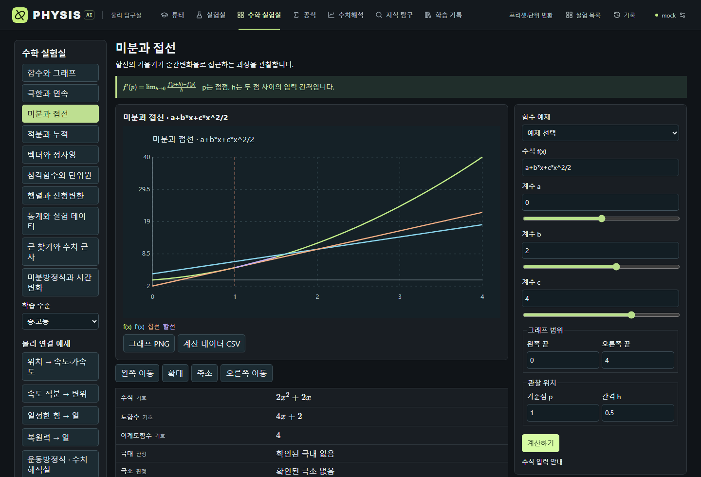

# PHYSIS AI

[](LICENSE) · [English](README.md)

PHYSIS AI는 한국어로 수학·물리 실험을 설계하고, 조건을 바꾸며 그래프와 측정값으로 예측을 확인하는 학습 도구입니다. v0.4에서는 입력한 위치 함수를 미분해 속도와 가속도를 구한 뒤, **Physics Bridge**에서 같은 초기 조건의 물리 실험을 열어 결과를 비교할 수 있습니다. [사용 안내](MATHEMATICS_LAB.md) · [물리 연결](PHYSICS_BRIDGE.md)



## Windows x64 배포본으로 시작하기

릴리스 페이지에서 `PHYSIS-AI-0.4.1-win-x64.zip`과 `SHA256SUMS.txt`를 받으세요. 쓰기 가능한 폴더에 모두 압축 해제하고 인터넷에 연결된 상태에서 **Setup-Runtime.cmd**를 한 번 실행합니다. 설정 도구가 공식 Python과 과학 계산 패키지의 해시를 검사해 이 폴더 안에 준비합니다. 이후 **Start-PHYSIS.cmd** 또는 오프라인 전용 명령 `Start-PHYSIS.cmd --offline`으로 실행합니다. [Windows 릴리스](https://github.com/stickleetoto/PHYSIS-AI/releases/tag/v0.4.1) · [설치·검증·문제 해결](WINDOWS_DISTRIBUTION.md)

## Windows에서 소스로 시작하기

Windows x64, Python 3.13 및 Node.js 22.12 이상을 준비합니다. 저장소 루트에서 다음 명령을 실행합니다. 첫 설치에는 패키지 다운로드를 위한 인터넷 연결이 필요합니다.

```bat
Setup-Windows.cmd
Start-PHYSIS.cmd --offline
```

기본 주소는 `http://127.0.0.1:8765`입니다. 설치 후에는 오프라인 모드에서 Mock 튜터, 수학·물리 엔진, 내장 문헌 검색을 사용할 수 있습니다. 종료하려면 콘솔에서 Ctrl+C를 누르세요.

## 수학 실험실

10개 실험은 함수와 그래프, 극한과 연속, 미분과 접선, 적분과 넓이, 벡터, 삼각함수와 단위원, 행렬, 통계와 회귀, 수치 근사, 상미분방정식입니다. 함수 그래프에서는 정의역이 끊기는 지점을 볼 수 있고, 적분 실험에서는 부호 있는 적분값과 기하학적 넓이를 비교할 수 있습니다. Physics Bridge는 지원하는 조건을 물리 모델의 입력 검증에 보내며, 물리 실험에서 얻은 시간·측정값을 통계 실험으로 가져올 수도 있습니다. [수학 검증](MATHEMATICS_VALIDATION.md)

## 시스템 아키텍처

| 구성 | 역할 |
|---|---|
| React · TypeScript | 실험 조작, 비교 재생, 그래프, 튜터 대화와 근거 표시 |
| FastAPI · SQLite | 실험과 리비전 저장, 대화 상태와 실험 변경 권한 관리 |
| Cognitive Pipeline | 질문 의도 분류 → 필요한 문맥 선별 → 계산·검색 → 설명 생성 → 검증과 부분 복구 |
| 물리 엔진 · 공식 레지스트리 | DSL로 입력을 검사하고 실행값, 단위, 적용 조건을 반환 |
| 지식 검색 · Provider Adapter | 내장 원문에서 근거를 검색하고, 선택한 공급자의 설명을 실행값·인용과 대조 |

현재 실험을 변경할 권한은 서버가 관리합니다. 필요한 조건이 부족하면 튜터가 되묻고, 후속 답을 같은 대화에 연결합니다. [파이프라인](COGNITIVE_PIPELINE.md) · [응답 계약](ANSWER_CONTRACT.md)

## 지원 모델과 검증된 공식

표의 한 행은 물리 모델 하나입니다. 23개 모델에 연결한 27개 공식은 차원과 엔진 계산 결과를 기준으로 검사합니다. 적용 가정과 허용 오차는 공식별로 다릅니다. [공식 검증 방법](FORMULA_REGISTRY.md) · [물리 모델 검증 기준](PHYSICS_VALIDATION.md)

| 물리 모델 | 등록 공식 |
|---|---|
| 자유낙하 | 정지 출발 후 높이 |
| 등속 운동 | 시간에 따른 위치 |
| 등가속도 운동 | 초기 속도와 가속도로 구한 위치 |
| 뉴턴 제2법칙 | 알짜힘과 질량으로 구한 가속도 |
| 운동 마찰 | 마찰에 의한 정지 거리 |
| 1차원 충돌 | 계의 총운동량, 반발 계수와 충돌 후 상대속도 |
| 용수철 진동 | 선형 용수철의 주기 |
| 감쇠 진동 | 선형 감쇠 진동의 가속도 |
| 단진자 | 유한 진폭 주기, 소각도 근사 주기, 비선형 각가속도 |
| 원운동 | 구심 가속도 |
| 진행 횡파 | 매질 입자의 횡방향 변위 |
| 진행 종파 | 매질 입자의 종방향 변위 |
| 파동 중첩 | 같은 방향으로 진행하는 두 파동의 합성 변위 |
| 정상파 | 위치·시간에 따른 변위 |
| 이상기체 | 이상기체의 절대압 |
| 열평형 | 단열된 두 물체의 평형 온도, 접촉 열교환 중 온도차 |
| 냉각 | 뉴턴 냉각 법칙에 따른 온도 |
| 열확산 | 막대의 열확산 단일 모드 온도 |
| 정수압 | 수심에 따른 절대압 |
| 부력 | 완전히 잠긴 물체에 작용하는 부력 |
| 연속 방정식 | 단면적에 따른 출구 유속 |
| 베르누이 흐름 | 수평 유선의 출구 정압 |
| 유체 추적자 | 균일 유동을 따르는 입자의 위치 |

## 근거가 있는 답변 살펴보기

튜터는 질문에 필요한 조건을 확인하고, 계산에는 실험의 실행값을 사용합니다. 기본 Mock 모드는 모델 없이 작동합니다. 저장된 모델 응답도 오프라인 Replay로 검증할 수 있습니다. 이번 배포의 실제 LLM 성능과 교육 효과는 미측정입니다. [소프트웨어 검증](EDUCATIONAL_EVALUATION_V3.md) · [평가 도구 사용법](EVALUATION_RUNNER.md)

v0.3.1에서는 수치 예측에 필요한 조건이 빠지면 튜터가 그 조건을 물어봅니다. **주장별 근거**에서 어떤 문장이 원문으로 직접 뒷받침되는지, 어떤 해석이 불확실한지 확인할 수 있습니다. 기존 23개 실험, 27개 공식과 내장 코퍼스를 사용합니다. [변경 이유와 판정 범위](RELIABILITY.md) · [v0.3.1 실측 보고서](release/검증결과-v0.3.1.md)

**튜터**에서 “뉴턴의 운동 법칙을 설명해 줘”라고 입력하세요. **답변 근거**에서 인용된 원문과 위치를 열고, **계산 검증**에서 현재 실험의 수치와 설명 속 값을 직접 대조할 수 있습니다. **보고서 저장**으로 같은 조건·출처를 기록합니다. “진자의 주기 공식은 언제 성립해?”라고 물으면 현재 진폭이 소각도 근사의 적용 범위에 드는지 확인할 수 있습니다.

**지식 탐구**에는 한·영 문헌 검색, 공식 27개와 기호 수학 도구, 6단계 학습 로드맵이 있습니다. 46개 OpenStax 절의 116문단은 설치본에서 읽을 수 있습니다. NASA 자료 3건은 서지 정보로 수록했습니다. 로드맵의 확인 문제에 답하면 제출 결과에 따라 선행 개념과 복습 순서가 바뀝니다.

명령 프롬프트에서 `Start-PHYSIS.cmd --offline`으로 실행하면 서버가 Mock만 사용하고 외부 연결을 차단합니다. 배포본에는 문헌 색인 원본, 기호 수학 엔진과 화면 글꼴도 들어 있습니다. 원문 링크로 출판사 사이트를 직접 열 때에는 인터넷 연결이 필요합니다.

## 실험 파일과 단축키

실험실에서 이름을 정하고 **이름 적용 → 실험 저장**을 누르면 현재 실험과 비교 구성을 JSON으로 내려받습니다. **실험 불러오기**는 원본을 보존하면서 새 실험을 생성합니다. 시각·속도·비교 물리량은 복원되고 재생은 일시정지 상태로 시작합니다. 저장 파일에는 변경 이력, 대화와 학습 기록이 들어가지 않습니다. 이전 버전에서 만든 실험도 열 수 있으며, 조건 이력은 업데이트 뒤 첫 변경부터 쌓입니다.

| 단축키 | 실험실 동작 |
|---|---|
| Space / N | 재생·일시정지 / 한 스텝 진행 |
| R | 등록 모델의 기본 조건과 시각 복원 |
| Ctrl+Z / Ctrl+Y | 현재 실험의 조건 변경 취소 / 다시 적용 |
| Ctrl+S / Ctrl+O | 실험 JSON 저장 / 열기 |

**프리셋·단위 변환**에서 모델별 목표와 관찰 질문을 확인하고 실험을 열 수 있습니다. 단위 변환은 현재 실험에 영향을 주지 않습니다. 시뮬레이션과 그래프의 PNG 버튼은 현재 표시를 이미지로 저장합니다. [전체 변경 기록](CHANGELOG.md)

## 첫 실험

1. 질문 입력란에 **“무거운 물체가 가벼운 물체보다 빨리 떨어지는 거 아니야?”**를 입력합니다.
2. 재생하거나 한 스텝씩 진행하면서 두 물체의 높이와 속도를 확인합니다. 기본값은 높이 20 m, 질량 1 kg과 5 kg, 중력 가속도 9.81 m/s²입니다.
3. **“그러면 두 물체의 질량 차이를 더 크게 해봐.”**라고 입력합니다. 같은 실험에서 질량 조건을 바꾸고 다시 계산합니다.
4. **“왜 결과가 같아?”**라고 묻습니다. 기본 조건에서 바닥에 닿는 시간은 약 2.019초입니다. 두 물체의 높이 그래프는 겹치지만 운동 에너지와 중력의 크기는 질량에 따라 달라집니다.

실험 조건에서 직접 값을 바꿀 수도 있습니다. 비교하려는 조건을 바꾼 후 위치·에너지·오차를 확인하고, CSV로 전체 시간 표본을 저장하세요. 수치해석을 관찰하려면 용수철 실험에서 적분 방법과 시간 간격을 바꿔 보세요.

## 튜터와 함께 탐구하기

| 화면 | 해 볼 활동 |
|---|---|
| 튜터 | 개념 설명에서 “높이 그래프 0.2초부터 0.8초까지 강조해 줘”라고 묻습니다. 발견 학습에서는 가설을 기록한 뒤 장면을 열고 관찰과 결론을 남깁니다. 개념 복습에서는 선택한 답의 근거를 확인합니다. |
| 실험실 | 진자 실험에서 튜터에 “줄 길이를 2 m로 바꿔 비교해 줘”라고 요청합니다. 비교 워크벤치에서 기준과 복제 실험의 주기·입력값·검증 상태를 비교합니다. 네 개까지 함께 재생하고 데이터를 각각 CSV로 저장할 수 있습니다. |
| 공식 | 자유낙하 공식을 선택하고 높이를 바꿔 예상값과 그래프를 확인합니다. 단위, 적용 조건과 유도 단계를 읽고 실험에 적용합니다. |
| 수치해석 | 같은 용수철 운동에 네 계산법을 적용합니다. 시간 간격을 줄이면서 최대 위치 오차, 상대 오차, 에너지 드리프트, 계산 시간을 비교합니다. |
| 학습 기록 | 가설·관찰·결론, 질문, 복습 답변, 북마크를 찾아봅니다. JSON 내보내기에 브라우저 학습 기록, 로컬 서버 실험 입력과 비교 구성이 포함됩니다. |

## AI 공급자와 오프라인 모드

기본값은 로컬 규칙으로 동작하는 Mock입니다. 오프라인 전용 실행은 `Start-PHYSIS.cmd --offline`을 사용하세요. 로컬 웹 앱과 내장 문헌 검색을 사용할 수 있고 서버의 외부 네트워크 연결은 차단됩니다.

외부 공급자가 필요할 때에는 서버 폴더의 `.env.example`을 `.env`로 복사하고 사용할 공급자에 해당하는 값만 설정하세요. 서버를 다시 시작한 뒤 AI 공급자 설정에서 모델을 선택합니다. 연결 확인은 모델 목록을 조회합니다.

| 공급자 | 서버 설정 |
|---|---|
| OpenAI / Anthropic | 각각 `OPENAI_API_KEY` / `ANTHROPIC_API_KEY` |
| 외부 Ollama | 서버 루트 주소 `OLLAMA_BASE_URL`과 서버에 설치된 모델 이름 |
| OpenAI 호환 API | `PHYSIS_COMPATIBLE_BASE_URL`에 API 기본 경로(보통 `/v1`), 필요한 경우 `PHYSIS_COMPATIBLE_API_KEY` |

키가 필요한 원격 서버는 HTTPS를 사용합니다. 저장된 응답을 재생하는 평가 절차도 제공합니다. [공급자 설정](AI_INTEGRATION.md) · [Replay 평가 사용법](EVALUATION_RUNNER.md)

## 검증 결과와 한계

v0.4 개발 시 백엔드 570개와 프런트엔드 32개 테스트가 통과했습니다. 소스판 브라우저 시나리오는 23개, 당시 로컬 Windows ZIP에서 검증한 수학 시나리오는 4개입니다. v0.4 검증은 Mock과 저장 응답을 사용했습니다. **실제 LLM의 교육 품질과 학생의 학습 효과는 미측정입니다.** [v0.4 검증 기록](release/browser-v04-packaged.json) · [검증 보고서](release/검증결과-v0.4.md)

물리 결과는 모델별 가정에 한정됩니다. 그래프는 유한한 표본으로 그리며 수식 문법과 계산 시간에도 제한이 있습니다. 앞으로 평가를 재개할 경우 같은 문항과 예산으로 수치·인용 오류 및 과도한 답변 보류를 비교할 계획입니다. [알려진 한계](KNOWN_LIMITATIONS.md) · [평가 계획](PIPELINE_ABLATION_RESULTS.md) · [변경 기록](CHANGELOG.md)

## 라이선스

Copyright 2026 DevSeat. DevSeat의 PHYSIS AI 원저작물에는 Apache License 2.0을 적용합니다. OpenStax의 교재 발췌문은 CC BY 4.0이며, NASA 자료는 서지 정보 3건입니다. 글꼴과 외부 라이브러리에는 각각의 라이선스가 적용됩니다. [LICENSE](LICENSE) · [NOTICE](NOTICE) · [제3자 고지](THIRD_PARTY_NOTICES.md) · [출처·저작자 표시](SOURCE_MANIFEST.md) · [공개 이력 검사](SOURCE_PUBLICATION_AUDIT.md)
