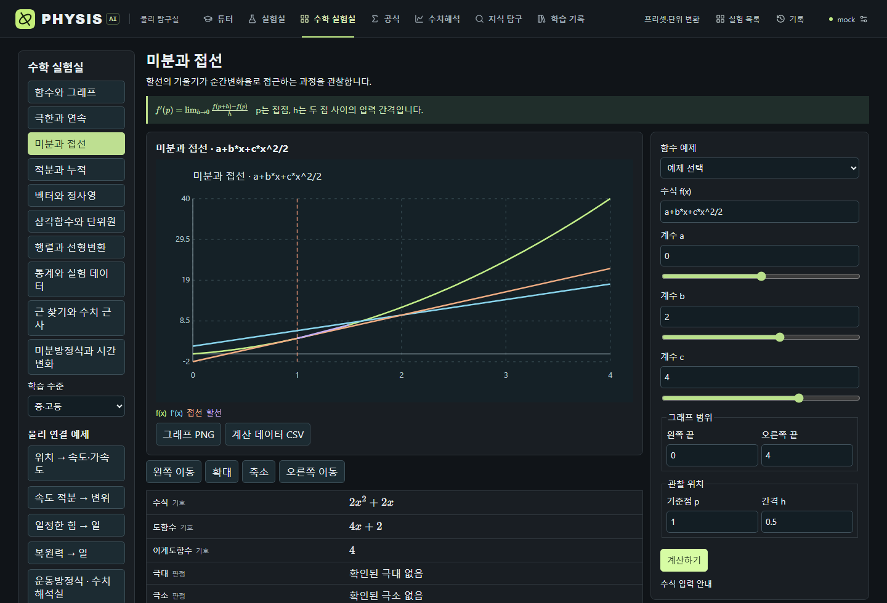

# PHYSIS AI

[](LICENSE) · [한국어](README.ko.md)

PHYSIS AI is a Korean-language mathematics and physics workbench. In v0.4 you can enter a position function, plot its derivative, then open a physics simulation with the same initial conditions and compare the measured velocity with your prediction.



## Run from source on Windows

Use Windows x64, Python 3.13 and Node.js 22.12 or later. From the repository root, run the following commands. Setup needs internet access to install dependencies and build the frontend.

```bat
Setup-Windows.cmd
Start-PHYSIS.cmd --offline
```

Open `http://127.0.0.1:8765`. The launcher serves the built UI and local API. After setup, offline mode supports the deterministic Mock tutor, simulations and built-in literature search. Press Ctrl+C in the launcher console to exit. The v0.4 release distributes source. The standalone Windows ZIP is on hold. [Windows distribution review](THIRD_PARTY_NOTICES.md#windows-binaries)

## Mathematics Laboratory and Physics Bridge

The ten experiments cover functions and graphs, limits and continuity, derivatives and tangents, integration and area, vectors, trigonometry and the unit circle, matrices and linear systems, statistics and regression, numerical approximation, and ordinary differential equations. For example, reverse an integral’s endpoints to compare signed accumulation with geometric area, or compare Euler and RK4 trajectories against the supported analytic solution. [Mathematics guide](MATHEMATICS_LAB.md) · [Mathematics validation](MATHEMATICS_VALIDATION.md)

Physics Bridge passes supported coefficients and units through the existing physics input validator. It connects position with velocity and acceleration, integration with displacement and work, and trigonometry with oscillation and waves. You can also import a measured time series from a physics run into the statistics experiment. [Physics Bridge](PHYSICS_BRIDGE.md)

## Physics experiments and formulas

The registry connects 23 models to 27 formulas. The tests check dimensions and engine results within each model’s assumptions and tolerances. You can compare up to four experiments, undo parameter changes, save experiments as JSON, and export measurements as CSV or graphs as PNG. [Formula registry](FORMULA_REGISTRY.md) · [Physics validation](PHYSICS_VALIDATION.md)

| Model | Registered relationships |
|---|---|
| Free fall | Height following release from rest |
| Uniform motion | Position at constant velocity |
| Constant acceleration | Position from initial velocity and acceleration |
| Newton’s second law | Acceleration from net force and mass |
| Kinetic friction | Stopping distance |
| One-dimensional collision | Total momentum and relative velocity after restitution |
| Spring oscillator | Linear spring period |
| Damped oscillator | Acceleration with linear damping |
| Pendulum | Finite-amplitude period, small-angle period and nonlinear angular acceleration |
| Circular motion | Centripetal acceleration |
| Transverse traveling wave | Transverse displacement |
| Longitudinal traveling wave | Longitudinal displacement |
| Wave superposition | Combined displacement of two traveling waves |
| Standing wave | Displacement by position and time |
| Ideal gas | Absolute pressure |
| Thermal equilibrium | Isolated equilibrium temperature and temperature difference during heat exchange |
| Cooling | Temperature under Newton’s cooling law |
| Thermal diffusion | Single-mode rod temperature |
| Hydrostatics | Absolute pressure at depth |
| Buoyancy | Buoyant force on a fully submerged body |
| Continuity | Outlet speed from cross-sectional area |
| Bernoulli flow | Outlet static pressure along a horizontal streamline |
| Fluid tracer | Position in a uniform flow |

## AI Tutor and Knowledge Engine

The React/TypeScript interface talks to a local FastAPI service. The service validates experiment inputs, executes the physics model and keeps revisions in SQLite. The tutor routes the question, requests missing conditions, retrieves evidence, and checks returned numbers and citations against the run and the cited text. The bilingual index contains 116 OpenStax excerpts from 46 sections. Three NASA bibliography records link to the originals. [Architecture](ARCHITECTURE.md) · [Cognitive Pipeline](COGNITIVE_PIPELINE.md) · [Knowledge Engine](KNOWLEDGE_ENGINE.md)

Mock is the default provider. Replay exercises the software with saved test responses. For an optional external provider, copy `.env.example` to `.env`, set the server-side credentials or endpoint, and launch without the offline flag. The adapters support OpenAI, Anthropic, an external Ollama server and an OpenAI-compatible endpoint. [Provider configuration](AI_INTEGRATION.md) · [Example settings](.env.example)

## Verification, limits and next steps

The v0.4 development record reports **570 backend and 32 frontend tests passed**, 23 source browser scenarios, and four mathematics scenarios exercised against the locally extracted Windows package. The UI passed TypeScript checks and a production build. The v0.4 verification used Mock and saved responses and made zero live model requests. **Real-model tutoring quality and student learning outcomes remain unmeasured.** [Verification record](release/browser-v04-packaged.json) · [Test report](release/검증결과-v0.4.md)

Numerical approximations depend on step size. Graphs use bounded sampling, and the expression engine enforces a restricted grammar and resource limits. The evaluation roadmap calls for comparing numerical and citation errors and unnecessary abstentions under a common question set and request budget. [Known limits](KNOWN_LIMITATIONS.md) · [Evaluation plan](PIPELINE_ABLATION_RESULTS.md) · [Changelog](CHANGELOG.md)

## License

Copyright 2026 DevSeat. DevSeat’s original work is licensed under the Apache License, Version 2.0. OpenStax excerpts retain CC BY 4.0. Fonts, dependencies and other third-party materials retain their respective notices and terms. [License](LICENSE) · [Notice](NOTICE) · [Third-party notices](THIRD_PARTY_NOTICES.md) · [Source attribution](SOURCE_MANIFEST.md) · [Source publication review](SOURCE_PUBLICATION_AUDIT.md)
